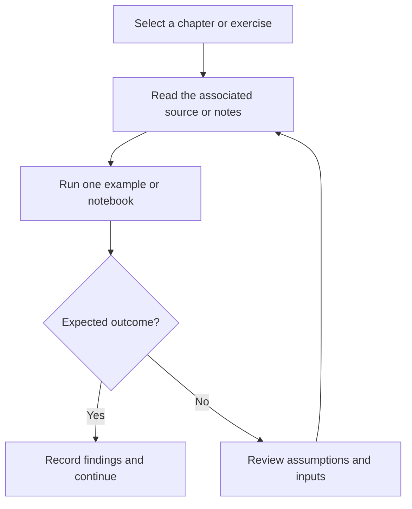

# Core Python Learning Path

Chapter-based Python learning exercises covering core syntax, collections, files, functions, and object-oriented programming.

## Project focus

Learning / reference collection. Use the directory map to choose a focused example or learning topic instead of treating the repository as one application.

## Workflow



The diagram describes how to work through the material; it is not a deployed service topology.

## Repository structure

| Path | Purpose |
| --- | --- |
| [`Chapter - 1 Introduction/`](Chapter%20-%201%20Introduction) | Topic-organized learning material and examples. |
| [`Chapter - 10 - Object Oriented Programming/`](Chapter%20-%2010%20-%20Object%20Oriented%20Programming) | Topic-organized learning material and examples. |
| [`Chapter - 11 Inheritence and More in OOP/`](Chapter%20-%2011%20Inheritence%20and%20More%20in%20OOP) | Topic-organized learning material and examples. |
| [`Chapter - 12 Advanced Python-1/`](Chapter%20-%2012%20Advanced%20Python-1) | Topic-organized learning material and examples. |
| [`Chapter - 13 Advanced Python 2/`](Chapter%20-%2013%20Advanced%20Python%202) | Topic-organized learning material and examples. |
| [`Chapter - 2 datatypes and variables/`](Chapter%20-%202%20datatypes%20and%20variables) | Topic-organized learning material and examples. |
| [`Chapter - 3 String/`](Chapter%20-%203%20String) | Topic-organized learning material and examples. |
| [`Chapter - 4 List and tuppe/`](Chapter%20-%204%20List%20and%20tuppe) | Topic-organized learning material and examples. |
| [`Chapter - 5 Dictionary and Set/`](Chapter%20-%205%20Dictionary%20and%20Set) | Topic-organized learning material and examples. |
| [`Chapter - 6 If  Else/`](Chapter%20-%206%20If%20%20Else) | Topic-organized learning material and examples. |
| [`Chapter - 7 Loops,basic pattern/`](Chapter%20-%207%20Loops%2Cbasic%20pattern) | Topic-organized learning material and examples. |
| [`Chapter - 8 functions/`](Chapter%20-%208%20functions) | Topic-organized learning material and examples. |
| [`Chapter - 9 File Input&Output/`](Chapter%20-%209%20File%20Input%26Output) | Topic-organized learning material and examples. |
| [`Project - 1 Water Snake Gun/`](Project%20-%201%20Water%20Snake%20Gun) | Project-specific source, resources, or learning material. |
| [`Project - 2 The Perfect Guess/`](Project%20-%202%20The%20Perfect%20Guess) | Project-specific source, resources, or learning material. |

## Getting started

```bash
git clone https://github.com/Raimal-Raja/Complete-Core-Python.git
cd Complete-Core-Python
```

```bash
python -m venv .venv
source .venv/bin/activate
```

On Windows PowerShell, activate the environment with `.venv\Scripts\Activate.ps1` instead.

Read an individual chapter or source file and run its examples independently. There is no single shared application entry point. Install only the dependencies used by the example you select.

## Verification

Use the setup commands and inspect the selected interface, example, or notebook with known inputs. This documentation review checks repository paths and dependency declarations; it does not claim fresh end-to-end execution or model-quality measurements.

## Contributing

Include reproduction steps, the affected path, expected behavior, and the checks you ran. Keep credentials, generated environments, and unnecessary build artifacts out of commits.

## License

No top-level license file is currently tracked. Check reuse permissions with the repository owner.
